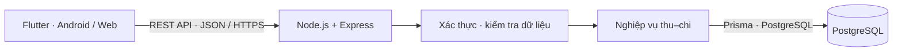
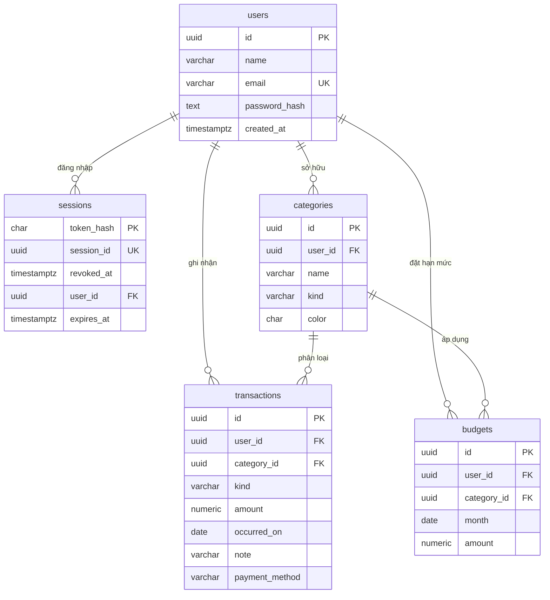
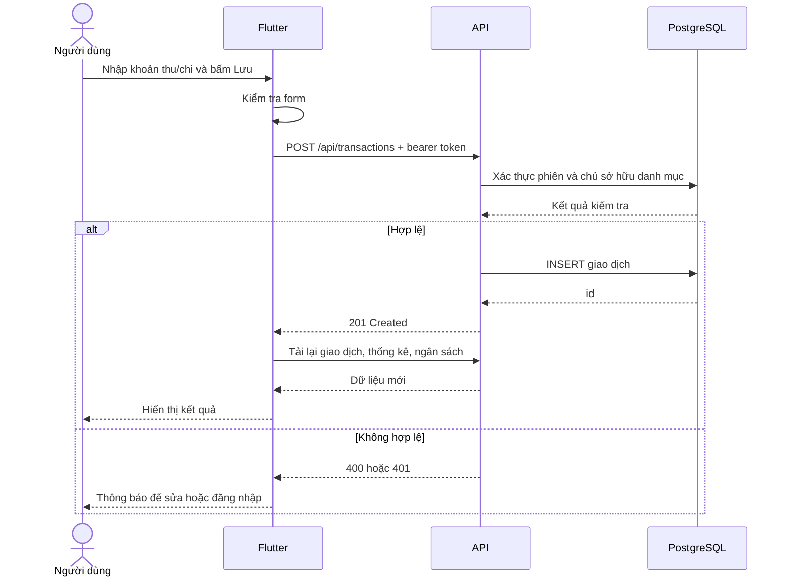

# Thiết kế hệ thống

## 1. Kiến trúc Client–Server

Flutter chỉ biết URL API, không giữ thông tin truy cập PostgreSQL. Mỗi yêu cầu nghiệp vụ mang bearer token; backend tìm tài khoản tương ứng và dùng `req.user.id` trong truy vấn. Client không được tự chọn `userId` để thao tác dữ liệu.

Backend là một server được chia thành các module trong cùng ứng dụng (modular monolith), phù hợp đề tài Client–Server; không phải hệ thống microservice. Docker chỉ phục vụ đóng gói và chạy local.

## 2. Ánh xạ chức năng → file

| Chức năng | Flutter | Backend |
|---|---|---|
| Đăng ký, đăng nhập, đăng xuất | `core/session.dart`, `screens/auth_screen.dart` | `src/modules/auth/` |
| Giao tiếp API, xử lý lỗi mạng | `core/api.dart` | `src/app.js` |
| Thêm/sửa/xóa giao dịch | `screens/editors.dart`, `screens/home_screen.dart` | `src/modules/transactions/` |
| Quản lý danh mục | `screens/editors.dart`, `screens/home_screen.dart` | `src/modules/categories/` |
| Ngân sách | `screens/editors.dart`, `screens/home_screen.dart` | `src/modules/budgets/` |
| Thống kê và biểu đồ | `widgets/summary_view.dart` | `src/modules/reports/` |
| Kiểm tra dữ liệu | Các Form validator | `src/validation.js`, CHECK/FK trong SQL |
| Database | Không truy cập trực tiếp | `src/prisma.js`, `prisma/schema.prisma`, `migrations/` |

### Ranh giới AuthModule và UserModule

Nên tách thành hai module trong cùng backend Express:
- `auth`: kiểm tra mật khẩu, đăng ký/đăng nhập, ký và xác minh JWT, tạo/rotate/thu hồi session. Đăng ký điều phối transaction tạo user + danh mục mặc định; login mới tạo session.
- `users`: truy cập dữ liệu tài khoản và trả hồ sơ hiện tại qua `GET /api/users/me`; không phụ thuộc auth. Truy vấn hồ sơ chỉ select id/name/email, không trả passwordHash.
- `categories`: sở hữu việc tạo danh mục mặc định; auth và script seed gọi lại hàm này.

Middleware xác thực xác minh access JWT rồi kiểm tra session còn hiệu lực trong DB. Cách này tốn một truy vấn mỗi request, đổi lại logout chặn access token ngay ở request tiếp theo. Hồ sơ đọc từ DB để tránh dữ liệu name/email cũ trong JWT. `/auth/me` được giữ làm alias tương thích.

## 3. ERD

File migration là nguồn đầy đủ cho tên cột, ràng buộc và index. Ngoài 5 bảng nghiệp vụ trên, `schema_migrations` ghi nhận migration đã chạy.

## 4. Quy tắc nghiệp vụ

1. Email không phân biệt hoa/thường; backend lưu chữ thường. Tên tài khoản dài 2–80 ký tự. Mật khẩu mới từ 8 ký tự, tối đa 72 byte UTF-8; đăng nhập vẫn nhận tối đa 128 ký tự để hỗ trợ tài khoản scrypt cũ.
2. Danh mục thuộc riêng một tài khoản và có loại `income` hoặc `expense`; tên không trùng không phân biệt hoa/thường trong cùng tài khoản và loại.
3. Giao dịch có số tiền nguyên dương 1–1.000.000.000.000 VND. Loại giao dịch phải khớp danh mục. Không dùng số âm để biểu diễn khoản chi.
4. Ngày giao dịch là ngày lịch `YYYY-MM-DD`, không chứa giờ/múi giờ. Báo cáo dùng mốc đầu tháng bao gồm và đầu tháng sau không bao gồm.
5. Có thể ghi ngày khác ngày hiện tại (2000–2099); báo cáo phản ánh ngày người dùng nhập. Ứng dụng không tự phân biệt khoản dự kiến/thực tế.
6. Một ngân sách cho một danh mục chi và một tháng. Lưu lại là cập nhật hạn mức; không tạo bản trùng.
7. Chi thực tế của ngân sách được tính trực tiếp từ giao dịch, không lưu bản tổng có nguy cơ lệch sau khi sửa/xóa.
8. Vượt ngân sách hiển thị cảnh báo; vẫn cho phép ghi nhận giao dịch.
9. Không xóa danh mục đang có giao dịch/ngân sách. Không đổi loại danh mục đang được tham chiếu. Có thể đổi tên/màu.
10. Bộ lọc và từ khóa chỉ áp dụng màn hình Giao dịch; thống kê tháng luôn tính tất cả giao dịch tháng đó.

## 5. Xác thực và bảo vệ dữ liệu

- Mật khẩu mới băm bằng `bcrypt` (cost 10); vẫn xác minh hash `scrypt` của tài khoản cũ. Mật khẩu mới tối đa 72 byte UTF-8 để tránh bcrypt cắt ngắn đầu vào. Không lưu mật khẩu bản rõ.
- Access token là JWT HS256 hạn 15 phút, dùng `JWT_ACCESS_SECRET`, kiểm tra issuer/audience/tokenUse/sub/sid/jti/exp/iat. Refresh token là chuỗi ngẫu nhiên 64 byte, hạn cố định 14 ngày, xác minh qua bản băm trong DB; không cần khóa ký riêng. JWT không chứa email/name/mật khẩu.
- DB lưu SHA-256 refresh token và expiresAt. Login đặt refresh token trong cookie HttpOnly. Refresh kiểm tra DB và chỉ cấp access token mới, không rotation/gia hạn. Logout xóa session và cookie; mỗi lần login tạo phiên riêng.
- Flutter Web dùng cookie do trình duyệt quản lý; native lưu cookie trong secure storage tại lớp HTTP. Access token giữ trong bộ nhớ. Khi mở app, refresh bằng cookie rồi lấy hồ sơ. Đăng ký xong client gọi login riêng.
- Truy vấn SQL dùng tham số `$1`, `$2`, ...; không ghép trực tiếp dữ liệu người dùng vào câu SQL.
- Kiểm tra quyền ở API và foreign key nhiều cột `(category_id, user_id, kind)` để ngăn tham chiếu danh mục tài khoản khác.
- Rate limit cho API và đăng nhập, giới hạn JSON 32 KB; lỗi server không trả stack trace/chi tiết DB về client.
- Kết nối Prisma dùng UTC để thời hạn phiên không lệch theo timezone của PostgreSQL.
- CORS chỉ cho origin cấu hình; CORS không thay thế xác thực.
- Endpoint tạo tài khoản dùng một giao dịch DB để lưu tài khoản và danh mục mặc định cùng nhau.

## 6. Luồng thêm giao dịch

## 7. Gợi ý phân chia cho nhóm 4 người

| Thành viên | Phần công việc có thể nhận |
|---|---|
| 1 | Database, migration, xác thực, kiểm thử phân quyền |
| 2 | API danh mục, giao dịch, tìm kiếm và phân trang |
| 3 | Flutter đăng nhập, danh mục, form giao dịch, kết nối API |
| 4 | Ngân sách, thống kê, giao diện tổng quan, kiểm thử và tổng hợp báo cáo |

Cả nhóm cần cùng chạy project và hiểu luồng Client–Server trước khi chia nhỏ. Viết báo cáo theo chức năng thực tế; không mô tả các tính năng chưa triển khai như ngân hàng hoặc ví điện tử.

## 8. Tài liệu tham khảo chính thức

- Flutter networking: https://docs.flutter.dev/cookbook/networking/fetch-data
- Flutter Android networking permission: cùng hướng dẫn trên.
- Express 5: https://expressjs.com/en/guide/migrating-5/
- Truy vấn có tham số: https://node-postgres.com/features/queries
- Giao dịch DB: https://node-postgres.com/features/transactions
- Flutter secure storage: https://pub.dev/packages/flutter_secure_storage

### Phân chia bên trong module auth

- `auth.controller.js`: nhận HTTP request, gọi schema/service, trả status và JSON; lỗi chuyển tới middleware chung của Express 5.
- `auth.schemas.js`: kiểm tra và chuẩn hóa dữ liệu đăng ký, đăng nhập, refresh/logout.
- `auth.service.js`: toàn bộ nghiệp vụ xác thực: băm/xác minh mật khẩu, cấu hình khóa, ký/xác minh JWT, hash refresh token, đăng ký, đăng nhập, kiểm tra phiên, refresh và logout.
- `auth.repository.js`: thao tác bảng session bằng Prisma; dữ liệu user qua repository của module users.

API dùng `name/email/password`, Prisma/PostgreSQL và cookie refresh token. Controller xử lý cookie/HTTP; service xử lý nghiệp vụ, repository truy vấn DB. POST auth yêu cầu X-Requested-With và kiểm tra Origin để bảo vệ các thao tác dùng cookie.
